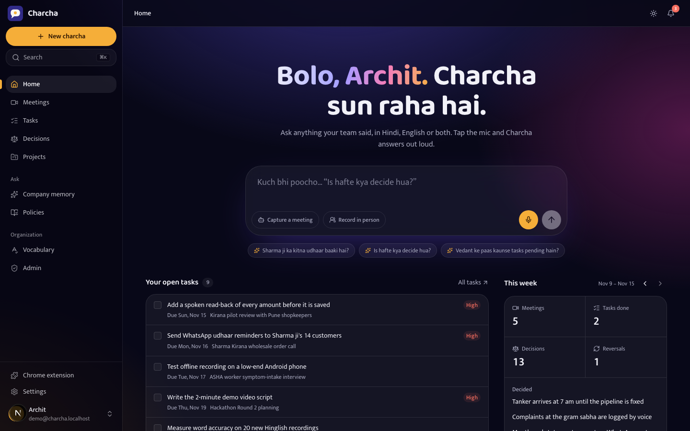
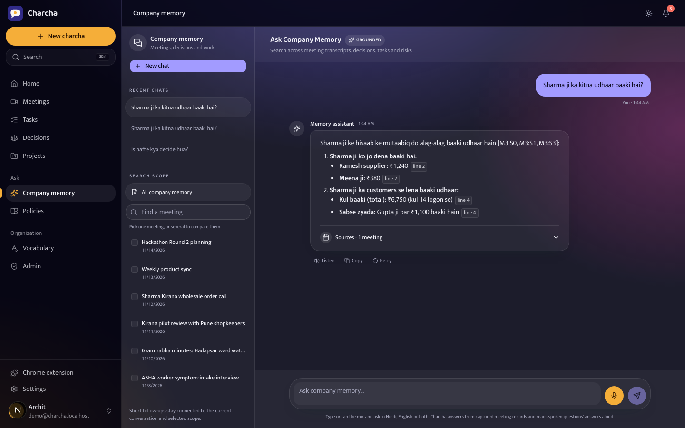
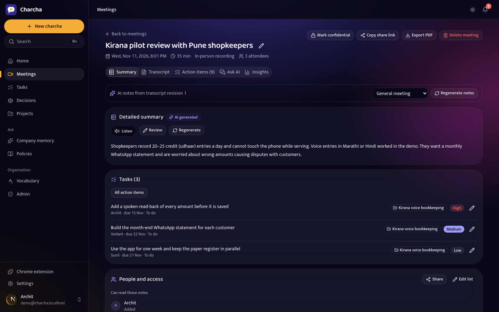
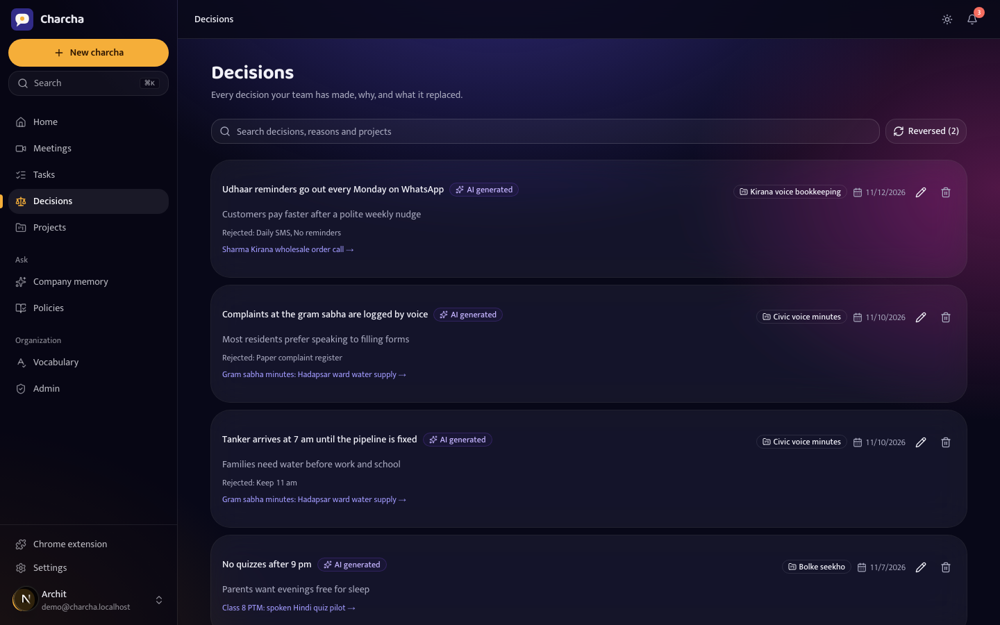
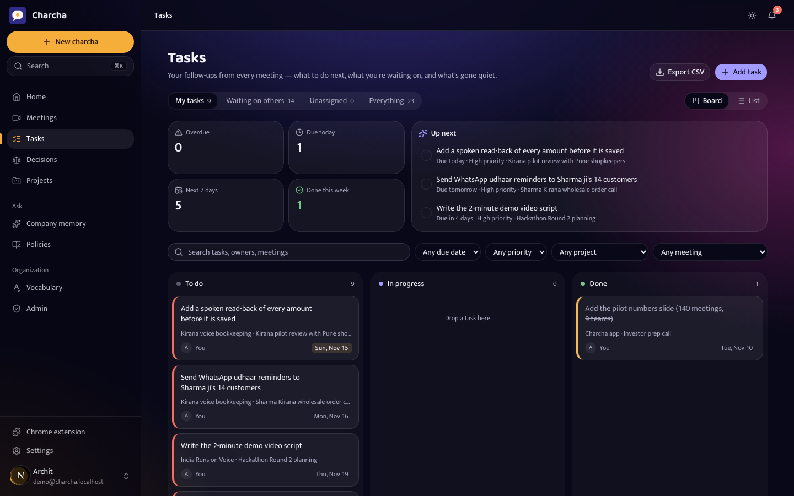
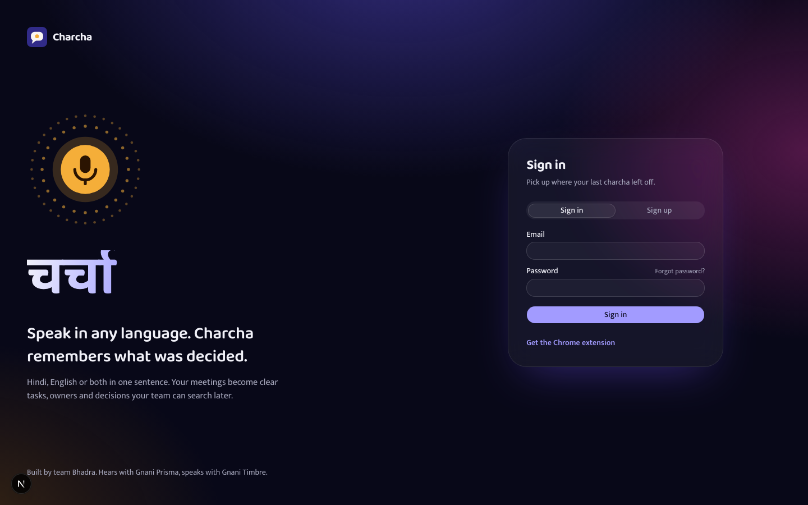
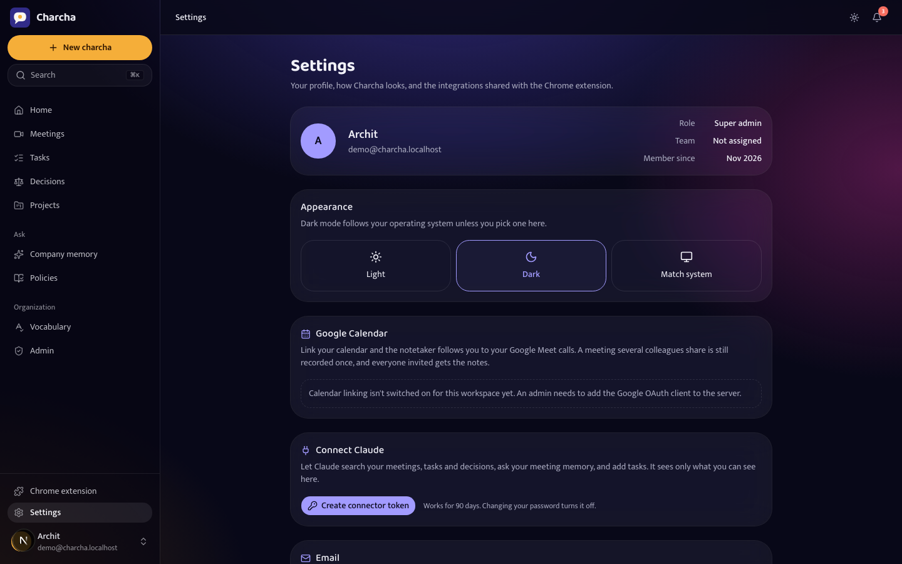
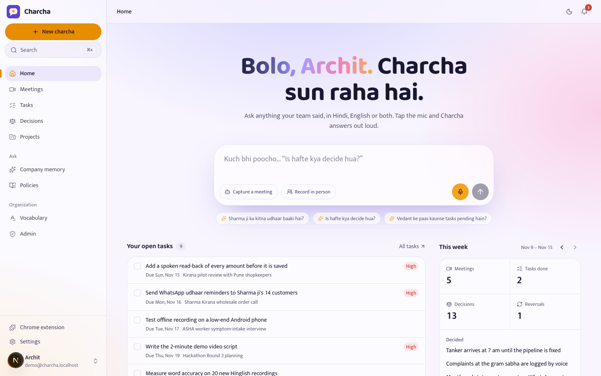
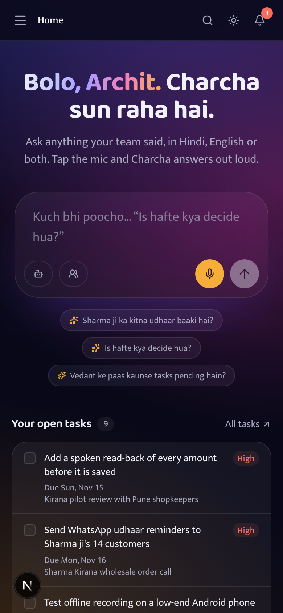

# Charcha (चर्चा)

**Voice-first meeting memory for Indian teams.** Speak in Hindi, English or both in one sentence: in a Google Meet, a Teams call or in person. Charcha turns the conversation into owners, tasks, decisions and searchable memory, and answers back out loud.

Built by **team Bhadra**: Archit and Vedant.

**Live app: https://34-58-54-115.sslip.io** (demo data is synthetic)



## Built on Gnani AI

| Gnani model | What Charcha uses it for |
|---|---|
| **Prisma v3** (speech-to-text, `codemix`, `indic-auto`) | Transcribes meetings, in-person recordings and spoken questions in Hindi, English and Hinglish |
| **Timbre v2.5** (text-to-speech, `hi-en`) | Reads answers and summaries aloud in Hinglish, and lets the notetaker **speak in the call** |

The loop is: **Prisma hears, Gemini thinks, Timbre speaks.**

## What it does

- **Ask by voice, hear the answer.** Tap the mic and ask "Sharma ji ka kitna udhaar baaki hai?". Charcha answers from your meetings, with line-level citations, and reads the answer aloud.
- **A notetaker in the call, like Claude Meetings** (see [docs/claude-meetings.md](docs/claude-meetings.md)):
  - It joins Google Meet (or Teams by link), records and turns on captions.
  - It announces itself in the chat.
  - It answers **"Charcha, …" spoken aloud or typed in the chat**, from that call so far, and says the answer out loud.
  - "Charcha recap" gives the key points, decisions and action items so far.
  - "Charcha, add task: Vedant to send the invoice by Friday" creates a real task.
- **Notes that hold up.** Summaries, tasks with owners and due dates, decisions with reasons and rejected alternatives, reversals of earlier decisions, and risks. Every item is backed by a quote from the transcript.
- **In-person recorder** for shops, field visits and gram sabhas, recording in 5-minute segments that survive patchy networks.
- **Claude connector (MCP).** Claude Desktop, Claude Code or claude.ai can search your meetings, read tasks and decisions, ask memory and add tasks: Settings → Connect Claude.
- **Privacy by default.** Only the people in a meeting can read it, confidential meetings stay closed even to admins, and live answers in a call never reveal company memory to guests.
- Also included: Jira two-way sync, Google Calendar auto-join, pre-meeting briefs, Google Sheets export, a policy assistant, and learned name corrections for Indian names.

## Screenshots

| | |
|---|---|
|  |  |
|  |  |
|  |  |
|  |  |

## Docs

- [docs/testing-guide.md](docs/testing-guide.md): what to test, with questions and expected answers from the demo data.
- [docs/claude-meetings.md](docs/claude-meetings.md): Claude Meetings research and how Charcha matches it, feature by feature.
- [DESIGN.md](DESIGN.md): the "night glow" design system.
- [CLAUDE.md](CLAUDE.md): project guide for Claude Code sessions (architecture, conventions, deploy).

## Architecture

| Area | Location | Stack |
| --- | --- | --- |
| Web workspace | `frontend/` | Next.js 16, React 19, TypeScript, Tailwind CSS |
| API + MCP server | `backend/` | FastAPI, SQLAlchemy async, PostgreSQL, MCP Python SDK (`/api/mcp`) |
| Notetaker bot | `backend/bot/` | Playwright + Chromium on Xvfb, PulseAudio (recording and voice), ffmpeg |
| Chrome extension | `src/`, `manifest.json` | Manifest V3, Vite |
| Speech | `backend/app/services/transcriber.py`, `tts_service.py` | Gnani Prisma v3, Gnani Timbre v2.5 |
| AI notes and answers | `backend/app/services/` | Gemini |
| Semantic memory | `backend/app/services/qdrant_service.py` | Pinecone or Qdrant (falls back to recent meetings) |

The notetaker joins a call when invited from a calendar event, the web app or the Chrome extension, records it, answers live questions, and hands the audio and captions to the API. The API transcribes the audio with Gnani Prisma, writes the notes with Gemini, stores them in PostgreSQL and indexes them for search.

## Quick start with Docker

1. Create the backend environment file:

   ```bash
   cp backend/.env.example backend/.env
   ```

2. Add `GEMINI_API_KEY` and `GNANI_API_KEY`. Google OAuth credentials are optional when using email/password login.

3. Start the application:

   ```bash
   docker compose up --build
   ```

4. Open `http://localhost:3000`. The API health endpoint is `http://localhost:8080/health`.

PostgreSQL is exposed on host port `5433`; Qdrant is exposed on `6333`.

## Local development

Backend:

```bash
cd backend
python3 -m venv .venv
source .venv/bin/activate
pip install -r requirements.txt -r requirements-dev.txt
uvicorn app.main:app --reload --port 8080
```

Frontend:

```bash
cd frontend
cp .env.example .env.local
npm install
npm run dev
```

Extension:

```bash
npm install
npm run dev
```

Always load the repository's `dist/` directory as the unpacked extension. `npm run dev` rebuilds that directory in watch mode; reload the extension from `chrome://extensions` after a change. Do not load the repository root: it contains development files that Chrome should never treat as extension assets. For a one-off distributable build, run `npm run build` and load the same `dist/` directory. The shared deployed API origin lives in `src/config.js`; matching origins must also be present in `manifest.json`.

After changing extension code, run the integration checks and rebuild:

```bash
npm test
npm run build
```

Reload the unpacked extension at `chrome://extensions`, then reload any open Meet tab. In a short test call, confirm that the Charcha control appears in the call, **Invite notetaker** brings the bot to the lobby, the toolbar badge changes to `REC` once it is admitted, **Stop notetaker** makes it leave, and a "notes are ready" notification opens the meeting. To review the popup design without installing anything, serve `src/` over HTTP and open `popup.html?preview=1` (or `?preview=login`, `?tab=meet`); it runs on built-in sample data.

Release checklist: bump `version` in `manifest.json` and `package.json`, update `extensionVersion` in `frontend/src/app/extension/page.tsx`, then run `npm run build:production` and zip `dist/` to `frontend/public/downloads/charcha-extension-v<version>.zip`.

Google OAuth requires a Chrome extension OAuth client for `manifest.json` and a web OAuth client in `NEXT_PUBLIC_GOOGLE_CLIENT_ID`. Email/password authentication works without Google OAuth.

## Environment

The complete backend template is in `backend/.env.example`. Important values:

- `DATABASE_URL`: async PostgreSQL connection URL
- `QDRANT_URL`: Qdrant service URL
- `GEMINI_API_KEY`: extraction, memory answers, policy answers, and contradiction checks
- `GNANI_API_KEY`: Gnani Prisma v3.0 audio transcription
- `JWT_SECRET`: application session signing secret; replace the development value in production
- `TEAM_ROSTER`: comma-separated names used as transcription keyterms
- `ADMIN_EMAILS`: comma-separated accounts with organization-wide access
- `ALLOWED_ORIGINS`: comma-separated browser origins allowed by CORS

## Validation

```bash
npm run build
cd frontend && npm run lint && npm run build
cd ../backend && .venv/bin/pytest -q
```

Backend tests require a reachable PostgreSQL database configured through `backend/.env`. External AI and Qdrant calls are mocked in route tests where appropriate.

## Deployment

Every push to `main` runs **Test and deploy** (`.github/workflows/deploy-vm.yml`):
1. **Checks:** it runs only the checks the change needs (backend tests, frontend type check, extension checks).
2. **Build:** it builds only the changed Docker images on GitHub, with a layer cache.
3. **Ship and restart:** it ships those images to the VM over SSH, then restarts each service only when it's idle, so a live meeting is never cut off.

A docs-only push doesn't deploy. A push with no image changes takes under a minute.

The VM serves HTTPS at the sslip.io name of its IP, with a Let's Encrypt certificate from the bundled certbot. HTTPS is required for the microphone. The server's nginx HTTPS config is `nginx/ssl.conf`, which is local to the server and git-ignored. Copy `nginx/ssl.conf.example` to set it up for a real domain.

### Extension releases and automatic updates

The web app exposes `/extension` as the first-install page. Before the Chrome Web Store listing is available it serves the versioned ZIP from `frontend/public/downloads/`; set `CHROME_WEB_STORE_URL` in the VM root `.env` after publication to switch the primary action to the Store listing on the next frontend build.

The checked-in manifest key keeps the extension ID stable as
`cdikchmjlbpieggcpdcpndlohoilelji`. Tag a release such as
`extension-v1.2.0` to build a production Chrome Web Store ZIP in GitHub
Actions. Upload that ZIP to the existing Chrome Web Store item with the same
ID and publish it. Chrome Web Store installs then update automatically when a
higher manifest version is published.

Chrome does not auto-update extensions installed with **Load unpacked**. Each
existing development user must remove the unpacked copy and install the Web
Store version once; subsequent releases update automatically. Do not add a
private signing key to this repository—the public manifest key is sufficient
to preserve the development extension ID.

Never commit `.env`, Google client-secret files, extension private keys, or generated recordings.

## Long meeting storage

The web recorder rotates the microphone into independently playable five-minute WebM segments. Each segment is written to browser IndexedDB before it is uploaded and transcribed, so the page never keeps a multi-hour recording in memory. Interrupted sessions appear under **Recover a session**. On finalization, FFmpeg joins the segments into one stored audio file, Gnani Prisma creates the final code-mixed transcript, and Gemini turns it into notes, decisions and tasks.

Production deployments must persist `RECORDINGS_DIR`. The included Docker Compose configuration mounts the `recordings_data` volume at `/app/recordings`.

If Qdrant is unavailable during ingestion, the meeting still commits and reports semantic indexing as pending. After Qdrant recovers, rebuild one meeting with `python scripts/reindex_meetings.py --meeting-id <uuid>` or omit the ID to rebuild the full meeting index.
