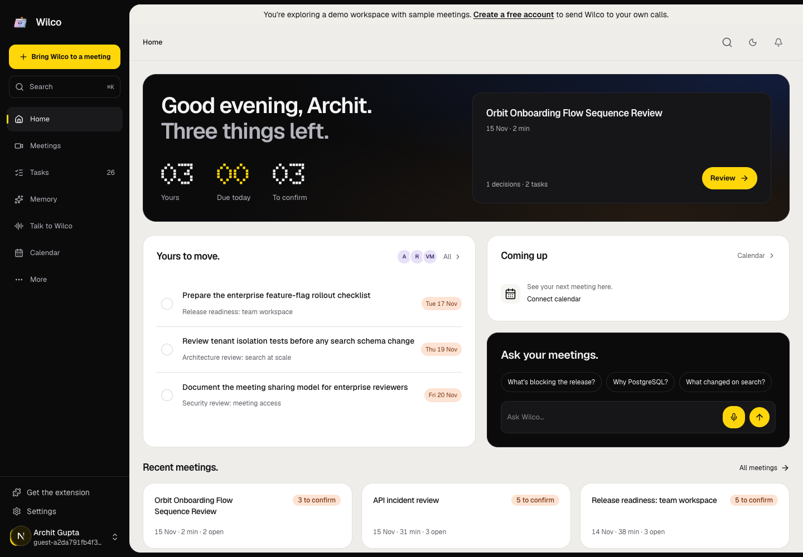
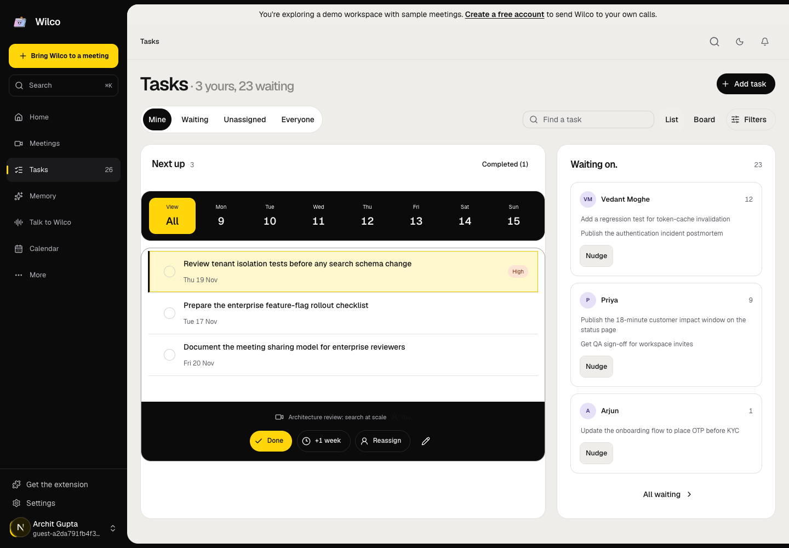
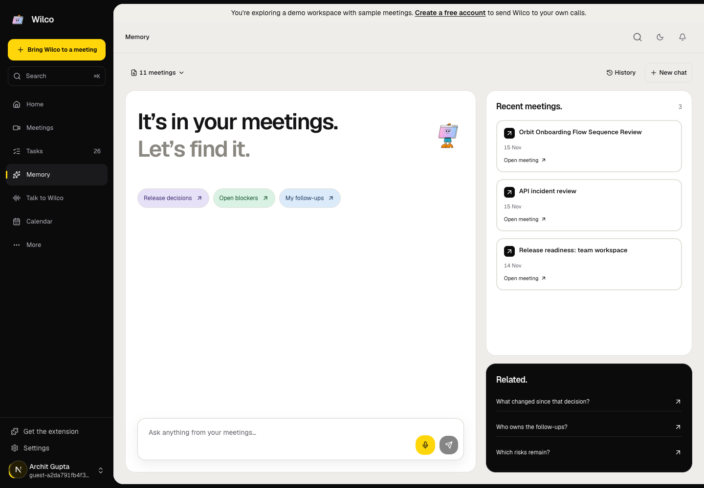
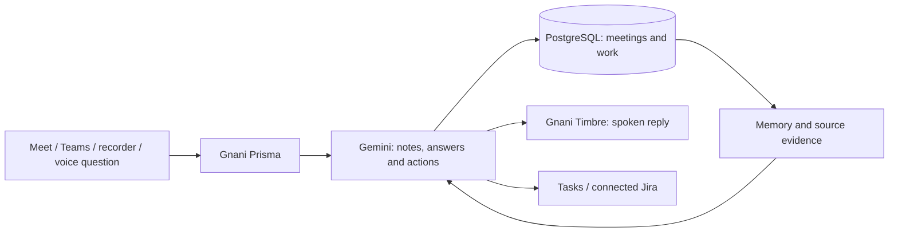

<div align="center">
  
  <h1>Wilco</h1>
  <p><strong>Your team’s language. Your team’s memory.</strong></p>
  <p>Say it in the meeting. Keep it moving after.</p>
  <p><a href="https://34-58-54-115.sslip.io">Try Wilco</a> · <a href="#the-60-second-demo">60-second demo</a> · <a href="#inside-the-workspace">See the workspace</a> · <a href="#run-it-yourself">Run it yourself</a></p>
  <p>Built by <strong>Team Bhadra · Archit &amp; Vedant</strong><br />For the Great Indian AI Internship Challenge · Powered by Gnani AI speech</p>
</div>

---

Your team switches languages without thinking. Work should follow just as naturally.

A release review starts in English, the blocker comes out in Hindi, and the deadline lands in Hinglish. By tomorrow, someone is asking who owns it. By Friday, someone is asking what was decided.

**Wilco turns that conversation into work your team can carry forward:** a task with an owner, a decision with its reason, and an answer that takes you back to the source. It joins the call, listens through Gnani Prisma, and speaks through Gnani Timbre. Software teams can keep talking the way they already do.



*Actual rendered redesign preview with synthetic software-team data. This interface is being implemented alongside the live product. [Capture details](docs/readme-assets.md).*

**Try it without signing up:** open the live app and choose **Try the demo** to explore a private sample workspace. Connecting your own calls and integrations requires an account.

## One sentence. A week of follow-through.

> “Arjun, onboarding flow Friday tak update karna. Pehle OTP, phir KYC—drop-off kam karna hai.”

An illustrative conversation. Here is the work it should leave behind:

| In the conversation | In Wilco | When it matters |
| --- | --- | --- |
| “Arjun … update karna” | An action item with an owner | The next stand-up starts with ownership |
| “Friday tak” | A deadline you can review | Follow-ups stay visible after the call |
| “Pehle OTP, phir KYC” | A decision and its stated reason | A teammate can understand the trade-off later |
| “Owner aur deadline kya tha?” | A spoken answer; Memory links to supporting evidence | You can ask, listen and verify |

**Make every conversation easier to act on, and every decision easier to trust.**

## The 60-second demo

**Video link: coming soon.**
<!-- DEMO_VIDEO_URL: replace the line above with the final public video link. -->

Follow a multilingual onboarding discussion from spoken instruction to owned task. Then ask Wilco who owns it and open the source. The demonstration uses fictional people and synthetic meeting content.

**Audio credit:** speech assets for the demo were generated using **Gnani AI’s Timbre API**, authenticated with our Gnani API key. The assets use Timbre v2.5 for English/Hinglish and v3.0 for Tamil/Marathi. Spoken demo questions also pass through Prisma before reaching Memory. The key stays server-side. Background music is separately generated with ElevenLabs; it is not attributed to Gnani.

The final video link will be added here when ready.

## A teammate across the whole meeting

| Moment | What you can do |
| --- | --- |
| **Before** | Link Google Calendar, invite the notetaker, and listen to a prepared meeting brief or missed stand-up. |
| **During** | Bring Wilco into Meet or Teams. Ask for a recap, an action item or an answer about the call so far. The mascot appears on camera and replies can be spoken aloud. |
| **Across languages** | Speak a question in Hinglish. Choose a supported language for spoken notes. Request running translated summaries in meeting chat. |
| **After** | Review summaries, owners, deadlines, decisions, alternatives and risks. Follow the evidence back to the transcript. |
| **When work moves** | Complete, snooze or reassign follow-ups; use Delivery Radar; create a Jira issue by voice from signed-in Talk to Wilco. |
| **Weeks later** | Ask Memory why a decision was made. Open its source instead of searching through old calls. |

Running translations are periodic text summaries of call captions, not simultaneous interpreted audio. Jira needs a connected project; external issue creation uses the signed-in account rather than trusting a speaker name in a shared call.

<details>
<summary><strong>More of what we built</strong></summary>

- **AI stand-in:** an absent teammate can provide a briefing and opt into a cloned voice. The stand-in is disclosed as AI, answers within supplied context and hands unknown questions back. It is instructed not to accept new commitments for that person.
- **Voice to FigJam:** meeting-scoped commands to open a board and draw or revise a flow. One-time Figma sign-in is required; real editor and remote-sharing acceptance are still pending.
- **“Who said that?”:** inspect a decision’s source, speaker label and timestamp, then hear the original recording excerpt when verified evidence and audio are available.
- **In-person recording:** five-minute segments saved locally before upload, with recovery for interrupted sessions.
- **Claude connector:** search meetings, inspect tasks and decisions, ask Memory and add tasks through MCP.
- **Connected follow-through:** Jira integration, Google Sheets export through the extension, WhatsApp sharing, project views and recurring stand-up digests.
- **Voice lab and vocabulary:** explore the speech integrations, review name corrections and manage consent-based speaker enrolment.

</details>

## Inside the workspace

The new design puts the conversation in an ink frame and the work on bright sheets. Yellow points to the next action. A debrief strip marks useful moments, while source details stay within reach.

| **Tasks — know what needs you** | **Memory — ask, then inspect the evidence** |
| --- | --- |
|  |  |

These are application screenshots, not generated UI concepts. They show the implementation preview; the live deployment may be on an earlier release. [Screenshot provenance](docs/readme-assets.md).

## Where Gnani does the work

**Prisma hears → Gemini reasons → Timbre speaks → Wilco keeps the result useful.**

| Technology | Its job in Wilco | Implementation |
| --- | --- | --- |
| **Gnani Prisma v3.0** | Recorded meetings, uploads and spoken questions; configured for code-mixed speech and automatic Indic language identification | [Transcription](backend/app/services/transcriber.py) |
| **Gnani Timbre v2.5 / v3.0** | Spoken answers, summaries, catch-ups and briefs; the demo’s speech assets | [Speech](backend/app/services/tts_service.py) |
| **Gnani voice cloning** | Optional, consent-based voice for an explicitly disclosed AI stand-in | [Voice cloning](backend/app/services/voice_clone_service.py) |
| **Gemini** | Structured notes, grounded answers, bounded action planning and translated summaries | [Generation](backend/app/services/gemini_service.py) |

Speech options include Hindi, Indian English, Hinglish, Tamil, Telugu, Kannada, Malayalam, Marathi, Punjabi, Bengali and Gujarati. These are integrated options, not a claim of equal measured accuracy across every language or code-mixed pair. Hinglish is our central demonstration.

## Our award fit

Descriptions below are verbatim from the supplied award brief, also listed on [Gnani’s programme page](https://www.gnani.ai/internship). These are our target categories, not awards already won.

| Track | Official description | Wilco’s case |
| --- | --- | --- |
| **Mixed Vibes Award** | “The best code-mixed voice experience across Hinglish, Tanglish and Benglish.” | Natural Hinglish becomes useful work and a spoken answer. Tanglish/Benglish performance needs dedicated evaluation. |
| **Jugaad Genius Award** | “The most creative or unexpected use of Gnani AI's models.” | Speech carries the workflow: capture, recall, briefs and an optional disclosed stand-in. |
| **Two-Person Army Award** | “The best project built by a team of two.” | Archit and Vedant built Team Bhadra’s meeting workspace, voice integrations and notetaker. |
| **Demo Day Drop Award** | “The best 60-second demo video.” | One conversation, one visible task, one source-backed payoff. Final link pending. |
| **Real Deal Award** | “The most useful real-world problem solved, for users such as farmers, kirana stores or rural health workers.” | Our chosen users are software teams losing context between meetings and delivery. We do not claim deployments with farmers, shops or health workers. |

Regional-language features also align with **Main Character**, but need language-specific proof. Noisy audio is under evaluation; no **Noise Canceller** performance claim is made here. Solo and location-based categories are not claimed.

## Trust is part of the product

Meeting access follows the recorder and explicitly granted attendees. Ordinary admin workspaces follow the same visibility rules; separate admin tools have defined privileges. Confidential meetings have additional restrictions. In-call answers stay scoped to that call so guests cannot query the organization’s wider memory.

Recording consent, optional voice enrolment and disclosed AI stand-ins are explicit. Memory exposes source links; extracted work can be reviewed. The action agent uses durable jobs, cancellation and replay handling. Speech is cached and AI usage is tracked. [Agent design](docs/meeting-action-agent.md) · [Voice workflow boundaries](docs/voice-workflows.md).

## Built to inspect



This is the recorded-audio and spoken-question path. Live commands and running translations also use meeting captions. Semantic retrieval supports Qdrant or Pinecone, with a recent-meeting fallback when vector search is unavailable.

The workspace is **Next.js 16 / React 19 / TypeScript**; the API is **FastAPI / async SQLAlchemy / PostgreSQL**. The notetaker uses **Playwright, Chromium and FFmpeg**; the extension uses **Manifest V3**.

The voice-workflow checkpoint records **560 passing backend tests**, frontend build/type checks, browser scenarios and synthetic media checks. Provider/Jira mocks are identified in the [verification notes](docs/voice-workflows.md). These are engineering checks, not a speech-quality, noisy-telephony or end-to-end latency benchmark.

## Run it yourself

```bash
git clone https://github.com/testing-archit/bhadra.git
cd bhadra
cp backend/.env.example backend/.env
# Set GNANI_API_KEY, GEMINI_API_KEY and a private JWT_SECRET in backend/.env.
docker compose up --build
```

Open **http://localhost:3000**; API health is **http://localhost:8080/health**. Use a recent Docker Compose version. Speech and model-backed actions need provider credentials. This stack starts the workspace, API, PostgreSQL and Qdrant; joining real calls additionally requires the [notetaker setup](backend/bot/README.md).

[Development, environment, extension and deployment](docs/development.md) · [Testing guide](docs/testing-guide.md) · [Voice workflows](docs/voice-workflows.md) · [FigJam setup and limits](docs/meeting-first-figjam.md)

## Built by two. Built for the whole team.

**Archit and Vedant · Team Bhadra.** We built Wilco around a belief: the way a team speaks should never be the reason its work gets lost.

Our first audience is software teams running stand-ups, design reviews, release discussions and incident calls. The next proof is real usage: fewer forgotten follow-ups, faster recovery of decisions, and reliable voice experiences across more Indian languages. Those are outcomes we want to earn.

**Speak naturally. Leave with clarity. Keep the work moving.**

<sub>Wilco was formerly Charcha. Legacy identifiers remain for compatibility. Last reviewed: 15 November 2026.</sub>
