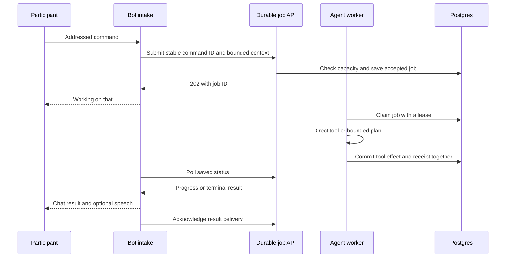

# Meeting action agent

Status: deployed to production at `25fec90`; real-call acceptance pending. Date: 15 November 2026.

Current voice workflow: [native FigJam and reliability release](voice-figjam-reliability.md), deployed at `eaa87de`. New bot commands select FigJam and request pairing when needed; the internal destination remains compatible for older API callers. Interactive requests now use supported Gemini thinking levels and the configured fast model.

## Behavior

The bot accepts addressed commands while recording and while previous work is running. Common commands go directly to a typed tool. Compound requests use one bounded planner call, then execute at most four steps.

Current tools:

- Open the shared meeting board.
- Create/edit/connect/move/remove board points, with safe undo.
- Record an action item for the meeting's final notes.
- Answer or draft text from this call's recent captions.
- Ask a clarification when a request is ambiguous or unsupported.

For example: “Wilco, build an onboarding flow and add a task for Ravi to review it.” The planner can open the board, draw the requested flow, and record the review task. Each completed step produces a saved receipt. Natural-language planning is tested with simulated model responses; live English/Hinglish command accuracy still needs validation.

Presentation remains the existing opt-in bot action. “Open and present a whiteboard” now waits for the durable board-open result before attempting presentation. The server reports board creation separately from the bot's local presentation result. Real remote reception in Meet remains unverified; `PRESENT_BOARD=0` remains the default.

Personal-account Jira writes, sending email, arbitrary code execution, external browsing, and private historical retrieval are not tools in this shared-call agent. A task recorded here is an internal action item; it is not confirmation of a Jira issue. Connected-account actions need authenticated actor binding in the next integration phase. Drafting text does not send it.

## Pipeline



Recording, caption upload, command intake, execution, status delivery, and speech have owned tasks. Model work is outside the bot's command-intake loop and outside database write locks. The async client reuses a small HTTP connection pool.

## Task state and recovery

Jobs persist in `meeting_agent_jobs`, attached to the existing capture request. `scripts/init_db.py` creates the new table/indexes through the project's existing schema workflow. The backend must be updated before the bot starts using the new endpoints; previous board/task endpoints remain compatible.

States are `accepted`, `running`, `succeeded`, `failed`, `cancelled`, and `needs_input`. The phase and completed-step count expose progress without leaking model prompts or treating an acknowledgment as completion.

- Stable command IDs deduplicate transport retries. Reusing an ID for different intent is rejected.
- A database constraint and serialized claims permit one active job per meeting. A global worker limit bounds simultaneous execution across API processes.
- Claims use row locking and lease tokens. Heartbeats maintain ownership; expired leases can be reclaimed up to three attempts within the original deadline.
- Tool effects and their receipts commit in the same database transaction. Recovery resumes after the last committed receipt. Inference can repeat after a crash before a checkpoint; committed effects remain deduplicated.
- Commit fencing checks the current job state, token, deadline, and lease. Late results from a cancelled or replaced worker cannot commit generated edits or tasks.
- Cancellation can arrive before submission. A cancelled-ID record prevents an in-flight delayed submit from reviving the request.
- Partial success is retained and reported when a later step fails. Cancellation does not undo already committed work; board undo remains explicit and version checked.
- Status results are recovered after a bot reconnect and acknowledged after posting. Meet chat has no transactional delivery API: a crash between posting a result and acknowledging it can produce a duplicate message. Database effects remain deduplicated.
- The full caption payload is removed from a job when it reaches a terminal state. Command/plan/receipt data follows the capture's database lifecycle; a comprehensive configurable retention policy remains separate work.

## Latency and resource bounds

Defaults:

| Control | Default |
| --- | --- |
| Accepted/running jobs per capture | 8 |
| Accepted/running jobs globally | 64 |
| Concurrent agent workers globally | 2 |
| Command deadline, including queue time | 45 seconds |
| Lease duration | 15 seconds |
| Interactive provider request timeout | 15 seconds |
| Planner steps | At most 4 |
| Structured model attempts per interactive call | 1 |
| Caption text in a command | At most 12,000 characters |
| Board node text/context for planning | At most 16,000 characters, plus at most 60 relevant edges |
| Bot command queue / additional intake backlog | 8 / 32 |
| Bot result polling | 500 milliseconds |
| Speech queue | 8 replies; speech older than 10 seconds is skipped |

Provider calls use a fixed-size thread pool; cancellation of an asyncio waiter does not create unlimited underlying SDK threads. The SDK's own request timeout and single-attempt setting bound calls that are already running. Interactive planner/board generation requests a zero optional thinking budget through the existing Gemini wrapper; model-specific minimum behavior still applies. Existing batch generation defaults remain unchanged, and usage attribution/recording is preserved.

The existing 2.5-second caption-settling rule remains for actions. Exact short control commands bypass that wait; this is safe for interrupting playback, not a claim of reliable speech endpointing. Streaming transcription, model first-token measurement, and streaming TTS remain follow-up work.

Admission is a short transaction. It checks prior results, capture state, queue counts, and database time in a combined query after acquiring the admission lock. A full queue returns a clear busy response and retry guidance. Worker/database failures back off rather than spinning.

## Spoken controls

- “Wilco, stop speaking”: stop current/queued speech; keep tasks running.
- “Wilco, cancel that”: cancel the latest local or accepted request; preserve completed work.
- “Wilco, cancel all requests”: cancel local and recovered active requests.
- “Wilco, status” / “What are you doing?”: query current task status.
- “Wilco, stop presenting”: stop presentation through the priority control path.

Controls bypass normal task execution. Cancellation and playback interruption are separate operations. The bot keeps handling subsequent commands after either operation.

## Validation

### Production release, 15 November 2026

Merged PRs #1–#3 and deployed application commit `25fec901b995ded0a540f3bd922758a92b01432f`. [Release workflow](https://github.com/testing-archit/bhadra/actions/runs/43661300614) passed tests, image build, deployment, and live verification. **457 backend tests passed** in CI. The live canary exercised authenticated admission, durable worker execution, real Gemini generation, board persistence, result delivery acknowledgment, and cleanup of its synthetic records. Its one request measured admission **33.69 ms** and completion **2,904.18 ms**, over container-local HTTP; this excludes voice, caption settling, Meet, WAN, and speech playback and is not a percentile or throughput claim.

Public app and health returned HTTP 200; unauthenticated access to the new command API returned 401. The running backend/notetaker images matched their release tags; bot runtime imports passed and Google auth state was present. Presentation is **enabled on this server for the user-authorized acceptance test**, while the product default remains off. Two-person Meet reception, English/Hinglish command recognition, interruptions, and acoustic-to-response latency still require a real call.

The live check caught a Google SDK schema serialization rejection. The shared wrapper now sends JSON Schema directly and still validates with the original Pydantic schema, including forbidden operation fields. A regression test uses the actual SDK HTTP serializer and confirms that unexpected fields are rejected. Rollback images/environment snapshots are retained; the earliest pre-agent image tags use suffix `rollback-43658908720`.

The full backend suite passed **456 tests**; additional focused bot/answer/agent checks passed after tightening action routing. Automated tests use local Postgres, mocked inference, and synthetic content. They cover admission/authentication, retry deduplication after a lost response, capacity limits, concurrent claims, cancellation before/during execution, deadlines, lease recovery, partial-step recovery, task/receipt atomicity, playback interruption, worker shutdown, caption controls, bounded context, usage-wrapper configuration, and the bot-to-API-to-worker-to-delivery flow.

A local load test sent 20 commands across five simulated meeting sessions, with 100 ms simulated inference and two allowed workers. The final local runtime check observed the timings below (the report also preserves initial and intermediate runs):

| Metric | Observed |
| --- | --- |
| Acknowledgment p50 / p95 | 342 / 398 ms |
| Completion p50 / p95 | 1,100 / 1,863 ms |
| Peak concurrent simulated inference | 2 |

The initial local run observed acknowledgment p95 of 1,905 ms; the intermediate run after admission query consolidation observed 776 ms. These development runs include code changes and ordinary local timing variation, so they do not isolate a single causal speedup. These are individual development measurements with simulated inference and ASGI transport, not production guarantees or acoustic-to-response latency. They exclude real provider, browser, audio, WAN, and Meet presentation behavior. The reproducible reports are in [agent-queue-benchmark.json](agent-queue-benchmark.json).

Run against a local database whose name ends in `_test`:

```bash
python backend/scripts/init_db.py
python backend/scripts/benchmark_meeting_agent.py --requests 20 --sessions 5 --provider-ms 100 --output /tmp/agent-benchmark.json
python -m pytest backend/tests -q
```

The benchmark rejects nonlocal databases and cleans up its own synthetic records. It is a workflow load test; it does not replace MLflow agent-quality evaluation or a live call.

## Observability

`agent_timing` metadata records measure planning, tool execution, and job runs; bot records correlate acceptance and completion. Prompts, caption text, provider exception bodies, and replies are not included in these timing records. Durable job payloads and meeting chat are separate data surfaces.

Native MLflow smoke validation stored and retrieved two traces, each containing run, plan, and tool spans. Optional backend export uses `MEETING_AGENT_MLFLOW=1`, `MLFLOW_TRACKING_URI`, and `MLFLOW_EXPERIMENT_ID`. Build with `ENABLE_AGENT_TRACING=1` to install the optional dependencies. Default installations do not add MLflow.

```bash
python -m pip install -r backend/requirements-agent-tracing.txt
python backend/scripts/validate_agent_tracing.py --tracking-uri file:///tmp/wilco-agent-traces
```

Use asynchronous export in deployment. Existing cost-ledger calls remain on the shared Gemini service; worker contexts start with clean user/meeting attribution.

## Before release

Confirm a live two-person English/Hinglish Meet session: command recognition, progress/chat delivery, real tool accuracy, correction/interrupt behavior, recording continuity, cancellation races, and latency under the intended meeting concurrency. Test provider errors and a backend restart during a compound request. Verify actual remote video reception before enabling presentation. Real-model quality and production latency have not been established by the local tests above.

Implementation details follow the existing [meeting agent plan](meeting-agent-plan.md) and [voice whiteboard report](voice-whiteboard.md).

Primary technical references: PostgreSQL's [SKIP LOCKED queue semantics](https://www.postgresql.org/docs/current/sql-select.htm) and the [Google Gen AI SDK options](https://googleapis.github.io/python-genai/genai.html). API options were also checked against the installed Python SDK, including its millisecond request timeout.
