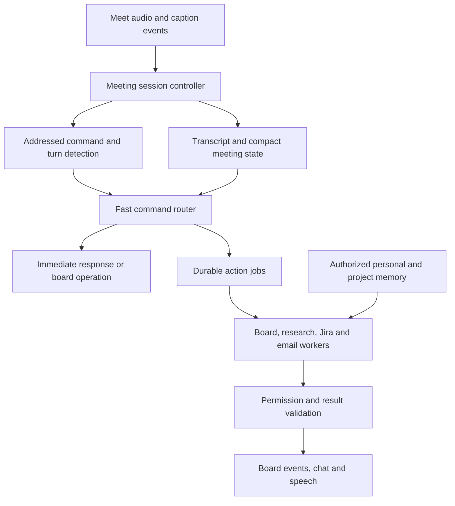

# Wilco meeting agent implementation plan

Date: 15 November 2026  
Status: First command-runtime checkpoint implemented on an isolated branch; live acceptance pending.  
Scope: Voice commands, collaborative whiteboards, reliable actions, personalized preparation, latency, and throughput.

## 1. Product outcome

Build a meeting teammate that listens throughout a call, acts on addressed requests, and carries relevant context into the next meeting. A discussion should become an editable artifact, an artifact should become assigned work, and the next meeting should start with what changed.

The initial experience must work in English and Hinglish, including corrections, interruptions, names, and mixed-language commands.

Example journey:

1. “Wilco, open a whiteboard for customer onboarding.”
2. “Add signup, verification, payment, and activation.”
3. “Put verification before payment.”
4. “What are we missing?”
5. “Undo that last change.”
6. “Assign verification to Archit and create a Jira ticket.”
7. Before the next meeting: receive a private, sourced brief about prior decisions, commitments, and changed ticket status.

The first milestone is this complete experience, rather than a large collection of disconnected agents.

## 2. Evidence and repository baseline

This plan follows research and read-only code inspection. Latency estimates below are inferred from code, not production benchmarks. Existing documentation contains historical architecture and earlier validation reports; those reports are not new verification of the current system.

Two checkouts were inspected:

- Shared checkout: `/Users/vedantmoghe/Downloads/bhadra`, base `10385b4`, with substantial uncommitted changes.
- Newer UI worktree: `/private/tmp/bhadra-reference-ui`, inspected at `a62644a`, with meeting-board code absent from the shared base.

Before implementation, inspect the latest branches and coordinate integration according to [coordination.md](coordination.md). Do not overwrite the shared checkout, recreate existing board features, or assume either inspected checkout is the current production release. The related [Claude Meetings report](claude-meetings.md) contains earlier research and implementation history; this document governs the proposed work below.

### Existing capabilities to extend

| Capability | Inspected implementation | Implication |
| --- | --- | --- |
| Meet participation and recording | `backend/bot/meeting_session.py`, capture service | Preserve one recording per meeting and subscriber behavior |
| Addressed voice/chat commands | Bot caption watcher, wake-name detection, live-answer/task routes | Refactor command handling rather than replace capture |
| In-call speech | Bot virtual microphone, Gnani Timbre synthesis | Decouple playback from listening and task handling |
| Private web voice | `backend/app/routes/live.py`, `live_conversation.py` | Separate path needing streaming and context improvements |
| Meeting boards | Newer worktree: `board_service.py`, `meeting-board.tsx` | Extend React Flow nodes/edges, revisions, and source references |
| Preparation | `prep_service.py`, `calendar_service.py` | Reuse attendee matching, recurring-meeting context, and citations |
| Email/Jira | Existing services, routes, email outbox patterns | Reuse connectors and delivery machinery after contract review |
| Usage accounting | `gemini_service.py`, `usage_ledger.py` | Preserve accounting for every new model path |

### Verified code-level latency concerns

- Spoken command handling waits for captions to remain unchanged for 2.5 seconds.
- The bot's outer loop sleeps five seconds between iterations. Together, these can delay handling roughly 2.5–7.5 seconds after the latest caption change in an otherwise idle loop. Caption delivery and other work add further delay.
- Command handling awaits generation, speech synthesis, and complete playback before advancing. Caption collection can continue, but subsequent commands are delayed.
- The web voice endpoint processes complete audio upload, transcription, digest lookup, model generation, and synthesized audio sequentially.
- Live answers may include up to 60,000 transcript characters. Private digest cache misses perform repeated queries per meeting.
- The newer board implementation normally flushes live captions every 15 seconds. Explicit commands need a separate immediate path.
- The Gemini wrapper intentionally creates per-call clients because global client reuse previously caused lifecycle failures. Do not remove that protection without a tested ownership model.

## 3. Product boundaries

### First release

- Addressed commands by voice or Meet chat.
- Immediate status feedback and interruptible speech.
- Create and edit a meeting board using structured operations.
- Preserve human edits, source references, revisions, and undo.
- Create Jira work through the authenticated requester's connector permissions.
- Personalized preparation based on authorized previous meetings and current work state.
- Reliable completion status, retries, and recovery.

### Later expansion

- Broader document/slide generation and research agents.
- Bot screen sharing or a richer live tile.
- General application building in an isolated execution environment.
- Additional meeting platforms and connectors after the Meet flow is reliable.

Opening a board initially means selecting/creating the board and posting its authorized link. Opening a browser tab for every attendee requires client participation; screen sharing is a separate feature. Do not promise either implicitly.

## 4. Architecture

### Session controller

Maintain one session owner per active capture. Track caption revisions, participants, active artifact, addressed turns, pending jobs, output playback, and cancellation. Listening, execution, playback, and meeting lifecycle checks must advance independently.

Use bounded queues and explicit task ownership. Avoid unlimited background tasks or a model call on every caption. Serialize browser mutations through a controlled adapter so independent tasks do not race over Meet controls.

### Fast router and specialized workers

Simple actions such as opening a board, stopping speech, or undoing a known operation should use deterministic handling where possible. Ambiguous requests use a small structured intent call. Complex work is delegated only after a command has been recognized.

| Worker | Responsibility |
| --- | --- |
| Board | Propose validated node/edge operations and layouts |
| Research | Retrieve evidence and compare options |
| Actions | Prepare and execute authorized Jira/email operations |
| Memory | Retrieve relevant commitments, decisions, and preferences |

These are bounded responsibilities, not a requirement to run four agents for every request. Start with typed tools and explicit workflows. Parallel reasoning is useful only for independent work.

### Event and action contracts

Define events with session ID, event ID, sequence, timestamp, source, and revision/finality. Preserve stable utterance IDs across caption revisions. A command needs a stable deduplication key and an explicit actor binding when it exercises personal connector authority.

Proposed action lifecycle:

`accepted → running → succeeded | failed | cancelled | needs_input | outcome_unknown`

Persist the command, actor, tool arguments, relevant authorization, attempts, result references, and correlation ID. Distinguish accepted work from completed work in chat and speech. For uncertain external outcomes, reconcile before retrying.

Cancellation stops pending generation, queued speech, and work that has not committed. It cannot erase an email already sent or an external write already completed; report the actual state and offer a supported compensating action.

## 5. Voice and latency plan

### First: improve the current caption path

1. Replace five-second command polling with event-triggered scheduling.
2. Add revision-aware turn handling and deduplication.
3. Separate command intake, execution, playback, and lifecycle checks.
4. Handle interruptions and “stop” promptly; prevent the bot's own speech from becoming a command.
5. Keep recent utterances and a compact summary in the fast context. Retrieve older evidence only when required.
6. Batch private digest database reads and invalidate caches when relevant data or permissions change.
7. Stream generation and speech where supported; retain a functional text fallback.
8. Preload context and connector metadata before scheduled meetings.

Early hypotheses may start cancellable read-only work. Do not commit a board mutation or external action from unstable speech before the finalized command and required authority are established.

### Second: benchmark transport/provider alternatives

| Candidate | Question to answer |
| --- | --- |
| Existing captions + current model/TTS | How much can orchestration fixes achieve at low cost? |
| Streaming STT → model → streaming TTS | Does it improve control, Hinglish accuracy, and measured latency? |
| Native realtime audio | Does conversational responsiveness justify its cost and operational differences? |

Deepgram Flux multilingual and Gemini Live are research candidates, not selected dependencies. Confirm actual account availability, current models, language performance, interruption behavior, pricing, and concurrency limits before choosing. Verify Gnani streaming interfaces before implementing against them.

### Initial performance targets

| Metric | Proposed target |
| --- | --- |
| First visible acknowledgment after command ends | p95 < 1 second |
| First spoken response after command ends | p50 < 1.5 seconds; p95 < 3 seconds |
| Simple board change visible after command ends | p95 < 2 seconds |
| Playback stops after interruption is detected | p95 < 300 milliseconds |

These are engineering targets, not current results. Report acoustic end-of-speech, caption arrival, turn finalization, first useful response, and completion separately. Record interruption detection latency separately from playback-stop latency. Do not use fast acknowledgments to conceal slow task completion.

## 6. Whiteboard behavior

Extend the existing React Flow board and version history. Suggested tools:

- `create_node`
- `update_node`
- `move_node`
- `connect_nodes`
- `group_nodes`
- `undo_operation`

The model proposes a structured change. Application code validates schema, permissions, node references, expected version, and operation limits before applying it.

Each operation records an ID, board version, actor, origin, and source reference. Preserve locked nodes and human edits. Version conflicts must rebase safely or request clarification; never silently overwrite a newer edit. Undo targets an operation and must not discard unrelated human work.

Distinguish a fact heard in the meeting, a confirmed team decision, and an AI suggestion. “What are we missing?” creates suggestions rather than asserting that the meeting agreed to them.

Resolve references such as “that box” using the active selection and recent interaction history. If multiple nodes fit, ask a focused clarification instead of modifying an arbitrary node.

Publish incremental board events with sequence/version information and a snapshot resync path after reconnect. Use the existing design system and components; follow [design-skills.md](design-skills.md) for UI changes.

## 7. Jira and email execution

Reuse current integration contracts after inspecting their authentication and retry behavior.

- Bind personal connector actions to an authenticated account. Caption display names and voice similarity alone are insufficient authorization.
- Resolve Jira project, issue type, assignee, required fields, and destination before writing.
- Resolve email recipients and content before sending. Existing explicitly configured recurring briefs can continue under their settings; ad hoc sends need an authorized request.
- Produce a concrete preview when required information or authority is missing. Do not request repeated approval for already authorized scope.
- Use a durable action ledger and stable local operation IDs. Verify external idempotency support rather than assuming it exists.
- On timeout after a write, mark the outcome unknown and reconcile before retrying. Observe provider retry guidance and rate limits.
- Link completed work to the board node, source discussion, and provider result.

Keep the existing email outbox as the delivery foundation where applicable. Sending an email is not equivalent to guaranteeing recipient delivery; present the status the provider actually confirms.

## 8. Personalized preparation and memory

Extend `prep_service.py`, rather than build another retrieval system. Retain matching by account ID/email, recurring-meeting continuity, and citations.

| Memory type | Examples |
| --- | --- |
| Personal preferences | Language, briefing length, working hours, preferred Jira projects |
| Relationship history | Promises to a person, unresolved questions, last agreed next step |
| Project state | Current decisions, linked artifacts, ticket status, superseded decisions |

Store source, date, scope, and confidence for remembered facts. Support correction, deletion, expiry where appropriate, and supersession. Separate an observed fact from an inferred preference.

The pre-meeting brief should answer:

1. What did we agree last time?
2. What did I promise?
3. What has changed since then?
4. What should I ask today?

Refresh time-sensitive ticket state close to the meeting, label stale or unavailable data, and handle moved/cancelled events without duplicate briefs. Reuse existing email preferences and calendar scheduling.

### Audience boundaries

Private preparation and shared in-call responses have different audiences. Preserve `meeting_visibility_clause` and `user_can_read_meeting` as authorization sources. Retain the existing live assistant's current-call-only context by default.

Historical data readable by one requester must not automatically be spoken to all attendees or added to a shared board. Historical sharing needs an explicit permitted audience. Recheck authorization when executing jobs, serving artifacts, and using cached results. Retrieved transcripts and documents are data, not instructions granting tools or permissions.

## 9. Throughput, reliability, and cost

Separate browser/media workers, API services, and action workers. Preserve the existing single-active-capture rule and subscriber lifecycle.

Start durable action jobs with Postgres leases and an outbox, reusing existing patterns. This is a deliberate proposed extension to the current inline-request architecture. Do not introduce Redis/Celery merely because they appear in historical documentation. Move to a dedicated broker only when measurements justify it.

- Bound per-session, per-tenant, and per-provider concurrency.
- Give live commands priority over background summaries and briefs, while preventing indefinite starvation.
- Recover leased jobs after worker loss; maintain session ownership and heartbeat semantics.
- Keep database transactions short. Do not hold board row locks across slow model/network calls; validate expected versions when committing results.
- Record active sessions, CPU/RAM per browser, audio streams, model limits, queue age, database connections, and connector limits.
- Degrade visibly to text or delayed execution when providers fail, without losing recording or pretending work succeeded.

Benchmark staged loads such as 1, 5, 10, and 25 concurrent sessions, increasing only while resources and provider quotas permit. Publish supported capacity from sustained measurements with headroom, not a guessed “huge throughput” claim. Measure simultaneous meeting joins separately from steady-state command traffic.

The original ₹0–500 monthly API target is not a verified budget for continuous voice or public scale. Track cost per meeting-hour, command, completed action, and tenant, including failed/speculative calls and hosting. Keep caption-based listening where adequate and invoke reasoning only when useful.

All new Gemini generation must retain the shared service and usage ledger. Alternative provider adapters need equivalent attribution and accounting before rollout.

## 10. Evaluation and release gates

Use MLflow traces and native evaluation APIs for agent quality; reuse suitable existing datasets after discovery. Use ordinary application tests for state machines, authorization, retries, and concurrency. Audio replay and real calls are required in addition to text-only agent evaluations.

Trace stages: audio/caption arrival, turn detection, routing, retrieval, model first token/completion, tool start/end, speech first byte, playback start/stop, artifact visibility, and overall action completion. Correlate by session, turn, command, and action IDs. Use monotonic durations within a process and account for cross-host clock differences.

Keep transcript content and personal data out of routine performance telemetry unless needed and appropriately controlled. Preserve usage attribution through asynchronous workers.

The evaluation set must include:

- English and Hinglish, names, accents, and code switching.
- Overlapping speakers and pauses mid-sentence.
- Mentioning Wilco without addressing it.
- “Don't create that,” “stop,” and corrections during generation.
- Caption revisions, replayed events, reconnects, and duplicate commands.
- Concurrent human/agent board edits and undo conflicts.
- Connector timeouts, uncertain writes, rate limits, worker restarts, and revoked credentials.
- Private historical facts that must not appear in shared output.
- Long meetings, stale context, unavailable providers, and interrupted audio playback.

Measure command precision/recall, false actions, task success, groundedness, tool correctness, duplicate writes, authorization failures, p50/p95/p99 latency, and cost. Set numerical quality thresholds after the baseline; authorization violations and duplicate external writes are release blockers in the test suite. Zero observed failures in tests is not a universal guarantee.

## 11. Execution phases

| Phase | Deliverable | Exit condition |
| --- | --- | --- |
| 0. Reconcile baseline | Confirm current branch, production version, existing board features, and ownership | Isolated implementation branch with known integration base |
| 1. Measure | Stage traces, representative command/audio cases, baseline report | Reproducible latency and failure breakdown |
| 2. Responsive commands | Event-driven intake, independent execution/playback, cancellation | Latency targets tested without command-quality regression |
| 3. Voice board | Structured editing, reference resolution, revisions, undo | Voice and human edits coexist without lost work |
| 4. Reliable actions | Actor-bound Jira/email workflows and durable jobs | Recovery/retry tests pass without duplicate writes |
| 5. Personal continuity | Better briefs, commitments, live work state | Cited, current preparation with correct audience boundaries |
| 6. Publication readiness | Load tests, quotas, recovery, rollout controls, cost report | Measured capacity meets agreed demand and quality gates |

Do not bypass foundational phases to add more agents. Provider selection follows comparative measurement, not a presumed winner.

### First implementation slice

- [x] Read current coordination notes and inspect latest relevant branches.
- [x] Establish the existing board implementation as the integration baseline (`25559c0`).
- [ ] Map the actual deployed command path and provider configuration without exposing secrets.
- [ ] Instrument the current path before behavior changes.
- [ ] Capture a representative English/Hinglish baseline, including interruptions.
- [x] Refactor command scheduling independently of capture and lifecycle checks (local validation).
- [x] Add bounded execution and playback queues with cancellation (local and database-backed tests).
- [ ] Compare before/after timings and command quality.
- [ ] Run a real Meet acceptance session before declaring the first slice complete.

### End-to-end milestone

In a five-minute live demonstration, open a board by voice, build a flow, correct it, interrupt Wilco, undo a change, and create one authorized Jira ticket. Subsequently verify a sourced preparation brief for the next scheduled meeting. The brief need not arrive within the five-minute demonstration.

Record latency, actual artifacts, action results, cost, and failures. Synthetic tests do not replace live validation of speaker handling or playback.

## 12. Decisions deferred until evidence is available

- Streaming provider/model and whether native audio is worth its cost.
- Verified Gnani streaming capabilities and production quotas.
- Target launch concurrency and monthly operating budget.
- Need for a dedicated broker beyond Postgres jobs.
- Screen sharing versus board links/client integration.
- Broader artifact types and general code-execution agents.

These decisions do not block measuring and improving the current command loop.

## 13. Research references

Reviewed during the planning discussion on 15 November 2026. Recheck availability, prices, and restrictions before implementation. Vendor documentation establishes capabilities, not Wilco performance.

- [Claude Meetings](https://support.claude.com/en/articles/18325154-use-claude-meetings): visible participant, addressed requests, live artifacts, connected tools, and audience boundaries. Public behavior does not establish its internal architecture.
- [Claude Whiteboards](https://support.claude.com/en/articles/18324319-get-started-with-claude-whiteboards): collaborative boards and documented connected-app context limitations at review time.
- [Anthropic latency optimization](https://platform.claude.com/cookbook/latency-optimization-latency-optimization): reduce round trips and context/output while evaluating quality.
- [Deepgram Flux quickstart](https://developers.deepgram.com/docs/flux/quickstart) and [languages](https://developers.deepgram.com/docs/models-languages-overview/): streaming turn events and Hindi/English support; code-switching quality still requires testing.
- [Gemini Live practices](https://ai.google.dev/gemini-api/docs/live-api/best-practices) and [tools](https://ai.google.dev/gemini-api/docs/live-api/tools): streaming, interruption, and model-dependent tool behavior.
- [LiveKit turn tuning](https://docs.livekit.io/agents/logic/turns/tuning/): turn-taking and interruption measurements; using its guidance does not require adopting its platform.
- [Google Meet Media API requirements](https://developers.google.com/workspace/meet/media-api/guides/get-started): preview enrollment restrictions make it unsuitable as an assumed unrestricted launch dependency.

## 14. Implementation log

Append implementation checkpoints here with commit/branch, scope, validation, measured outcomes, and remaining work. Update the coordination handoff as well. ### Checkpoint 1 — command scheduling and timing

Branch: `codex/meeting-agent-pipeline`, base: fetched `origin/main` at `25559c0`.
Worktree: `/private/tmp/bhadra-meeting-agent`.

Implemented:

- Independent bounded intake, execution, and playback workers; caption-event wakeups and a 500 ms typed-chat/settling check.
- Preserved the existing 2.5 second settling rule; identical caption repeats no longer postpone settling.
- Preserved the existing board/task/answer routes and serialized command browser controls.
- Moved caption uploads and synchronous stop-state requests off the command/lifecycle path.
- Async ffmpeg playback with process termination/reaping and temporary audio cleanup on shutdown.
- Correlated metadata-only stage timings and optional MLflow export; optional image dependencies are behind a build argument.
- Added a synthetic trace validator; observed four stored and retrievable traces for two commands.

Validation: 17 focused bot/runtime tests passed, Python compilation passed, and diff whitespace checks passed. Tests cover queue backpressure, continued execution during slow playback, caption wakeups/revisions, failure recovery, lifecycle exit, exporter failure, and playback cancellation cleanup. No provider requests or real meetings were used.

Remaining: production version/configuration confirmation, real English/Hinglish/audio baseline, acoustic-to-response timing, model/TTS streaming spans, explicit spoken interruption, durable action cancellation/reconciliation, complete frontend/backend regression suite, and live Meet/Teams acceptance. Queue cancellation here is session-shutdown cancellation; it is not a claim of completed barge-in or durable actions. No production latency or capacity improvement has been measured; no deployment is included.

The checked instrumentation is a foundation. Phase 1 and Phase 2 exit criteria remain open until real-call measurements and acceptance pass.

### Checkpoint 2 — voice board operations and presentation prototype

Implemented structured board commands with bounded operations, temporary references for complete flows, locked-point protection, command-id replay handling, safe undo, and conflict checks against concurrent human edits. Generation runs outside database locks, including the existing autonomous board refresher. Bot-only board state/command routes reuse machine authentication; no external connector writes were added. Wilco and the legacy wake name are recognized.

Added an opt-in Meet canvas presenter, off by default with `PRESENT_BOARD=0`. It renders only board content, updates from saved state, and stops its tracks/timers. A real local Chromium test sent the canvas through WebRTC, verified a received frame/live update, repeated presentation, and stop. This does not establish real Meet compatibility or remote attendee reception.

Validation: 434 backend tests passed against local Postgres; additional focused board tests passed after strengthening polite undo handling and protection of intervening human edits. No actual model generation or real meeting was exercised. Research, reproduction instructions, synthetic screenshot, and live acceptance requirements are in [voice-whiteboard.md](voice-whiteboard.md). No deployment, vendor subscription, or production performance claim.

### Checkpoint 3 — durable action agent and responsive controls

Added a bounded, current-call tool agent with direct routes for common requests and at most four planned steps for compound requests. Current tools open/edit boards, capture action items, answer/draft from recent call context, and ask clarifying questions. Model-bound requests now return an accepted job immediately; progress and final results are delivered independently. Personal-account connector writes are not part of these tools.

Postgres jobs save intent IDs, plans, leases, deadlines, receipts, and results. Tool writes and receipts commit together; recovery resumes completed plans without repeating committed effects. Fencing blocks cancelled/replaced workers from committing generated writes. A cancellation arriving before submission persists a cancelled-ID record. Status lookups expire overdue jobs even if workers are offline.

The bot uses a persistent async HTTP client and recovers undelivered results. Priority speech/task/status controls bypass ordinary task execution, with playback cleanup, bounded intake backlog and speech queues, and stale-speech suppression. Normal action settling remains 2.5 seconds. Model requests use bounded context/output, single interactive attempts, request timeouts, and a fixed provider thread pool. Cost attribution is reset per job and remains on the shared Gemini wrapper.

Local load check: 20 commands across five simulated sessions, 100 ms simulated inference, two workers. After admission query consolidation: acknowledgment p95 776 ms and completion p95 2,110 ms. These exclude real models, audio, WAN, and Meet. Two native MLflow agent traces were stored/retrieved, each with run/plan/tool spans. See [meeting-action-agent.md](meeting-action-agent.md) and [benchmark evidence](agent-queue-benchmark.json). Full test validation is recorded in that guide. No deployment or production latency claim.

Checkpoint 3 validation: 456 tests passed in the full backend suite; focused bot/answer/agent checks passed after routing refinements. Python compilation and whitespace checks passed. Live model accuracy, acoustic-to-response latency, remote Meet presentation, and authenticated Jira/email execution remain open.

Final local runtime benchmark (same 20 requests/five sessions/100 ms simulated inference): acknowledgment p95 398 ms; completion p95 1,863 ms; peak concurrent simulated inference 2. Initial and intermediate observations are retained in the report; variation and code changes prevent treating this as an isolated causal speedup or a production guarantee.
