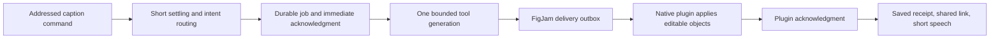

# Voice reliability and shared FigJam

15 November 2026. Implementation ready for release; production verification pending.

The real-call test exposed the difference between a successful model/API canary and a usable voice command. Production metadata showed one `open_board` job and no drawing job. Gnani usage was real: Timbre v2.5/Nalini/hi-en, with eight speech events and five Live replies using the slower Gemini 3.8 model. A synthetic production speech request returned a valid mono 24 kHz MP3 in 1,357 ms. No real meeting transcript or recording was printed during diagnosis.

## Corrections

- The old open-only dispatch dropped drawing instructions in “open a whiteboard and draw …”. Bare opening requests now avoid inference; opening plus drawing goes directly to one board-generation call. Mixed board/task or external-action requests retain the planner.
- The wake-word matcher now finds repeated Wilco commands within one unpunctuated caption block. Caption batches are 250 ms and command settling is 800 ms, down from 1,000 ms and 2,500 ms. These are configured waits, not an acoustic latency measurement. Repeat “Wilco” for each command.
- Chat delivery waits for the input to clear rather than always sleeping 800 ms after sending. URLs and opaque board IDs stay in chat and are omitted from spoken confirmations.
- Meet speech uses a Web Audio microphone containing only decoded provider speech and silence. It never captures meeting playback. Playback cancellation stops its source; microphone state is set explicitly rather than blindly toggled. Teams retains its older Pulse playback path.
- Live pauses automatic voice activity detection during playback and for 350 ms afterward. Use Interrupt to stop speech. Automatic spoken barge-in is intentionally unavailable until acoustic echo handling is validated. The utterance silence wait is 550 ms, down from 900 ms.
- Interactive planning, whiteboard generation and Live replies use the configured fast model. Live replies have an eight-second provider timeout. Independent transcription/context work runs together; the meeting digest uses three batched queries instead of up to 25 sequential queries.
- Live transcription gets priority before the next batch chunk. It has bounded retries and a 12-second deadline. It cannot preempt an already running provider request. Account concurrency and cross-process 429s still limit throughput; this does not increase a vendor quota.
- English speech requests use `en-IN` and the configured English voice, default Shlok. Hinglish retains the configured fast voice. Regional voices retain their existing path. Every paid request remains on the existing usage ledger.



## FigJam workflow

The user selected FigJam/Figma. New bot board commands request this destination. Without a paired file, the bot asks for setup and does not silently draw into Wilco's built-in board. The API's legacy internal destination remains compatible for older callers and isolated release canaries.

1. In the live meeting page, paste the shared FigJam file link and get a one-time code.
2. Download the development plugin there, unzip it, and import its manifest through Figma desktop → Plugins → Development. This plugin is not published in Figma Community. Organization plugin policies still apply.
3. Open the matching FigJam file, run Wilco meeting commands, paste its link and the code, and keep the plugin open.
4. Say “Wilco, draw a signup, verification and payment flow.” The plugin creates native shapes and connectors. Rename/move/remove/undo requests operate on Wilco-created objects; unrelated native content is left alone.
5. Use Figma's Share button to choose collaborators. Share the FigJam browser tab in Meet when presenting. Automatic bot presentation of a private FigJam file is not implemented; Wilco does not have that file's browser session.

Pair codes expire in five minutes and can be redeemed once for the selected file. Bridge tokens are hashed in Postgres, live only in plugin memory, are scoped to one capture/file, expire after eight hours, and stop working when the meeting ends or the recorder disconnects. Only the recorder can connect the file. The plugin's network allowlist contains the configured Wilco origin. The backend never receives a Figma password or personal API key.

Tool output is mirrored internally for planning and saved as a durable delivery. Success requires plugin acknowledgment; a stale connection, conflict or unconfirmed delivery asks the user to check/reconnect rather than claiming a native write. Delivery IDs and plugin metadata prevent replay from duplicating native objects. Native human edits are synchronized optimistically and protected by a preflight conflict check. Errors can leave a partially applied external edit; inspect the native file before retrying. Cancellation stops queued deliveries, but cannot recall a remote mutation already in flight.

The built-in live draft is now optional and does not mount or run its polling while collapsed. Existing notes/revisions remain available. Pairing starts a fresh FigJam mirror and preserves the prior internal draft in revision history.

## Verification

- 468 backend tests passed on isolated Postgres, including paired/unpaired routing, token scope/replay, native acknowledgment, cancellation, cross-origin scope, command recognition, mixed instructions, priority admission and audio cancellation.
- Five Node tests exercised the native shape/connector implementation, replay, human-edit conflicts, locks/deletions during planning, and preservation of unrelated objects.
- Frontend typecheck and production build passed.
- Real Chromium/WebRTC audio proof: 24 kHz synthetic speech decoded at 48 kHz, remote RMS 0.19454 with dominant frequency 433.59 Hz for a 440 Hz source, unrelated speaker RMS below 0.005, stopped RMS zero, malformed audio rejected. This is synthetic transport validation, not a real Meet voice test.
- Native MLflow dataset/scorer evaluation: 10 synthetic command routes, all correct. Run `414daf761f2f45a9a0385cc8bec0d489`; persisted application trace `tr-d16c0829b723472e1d542df8fe127eec`. This evaluates routing, not live model/audio accuracy or Figma account access.
- Browser walkthrough: pairing/code copy, connected shared link, no hidden-draft requests, mobile overflow, speaker-echo injection without another turn, and interruption followed by another captured turn all passed. API writes and voice responses were mocked; the browser used real Web Audio/MediaRecorder playback with a synthetic tone. [Desktop](screenshots/wilco-figjam-connection.png) / [mobile](screenshots/wilco-figjam-mobile.png).

Reproduce the optional evaluation and browser proof with the tracing/browser tools installed:

```bash
uv run python backend/scripts/evaluate_voice_routing.py
python backend/scripts/validate_browser_voice.py --chromium /path/to/chromium
node --test integrations/figjam/code.test.mjs
python tools/package-figjam-plugin.py --origin https://your-wilco-origin
```

Deployment verification also exercises a synthetic Gnani speech → Prisma → fast reply → Timbre pipeline and records separate stage timings. It does not use human audio or join a real call. A connected Figma account/file and another Meet attendee are still needed for final native-edit and remote-presentation acceptance.

Primary references: [Figma remote client access](https://developers.figma.com/docs/figma-mcp-server/remote-server-installation/), [FigJam native objects](https://developers.figma.com/docs/plugins/working-in-figjam/), [Gnani speech interfaces](https://github.com/Gnani-AI-Mintlify/gnani-vachana), [English voice catalog](https://www.gnani.ai/text-to-speech/english). The official remote MCP supports FigJam writes, but currently restricts custom clients; the native plugin avoids claiming that Wilco already has approved MCP access.
